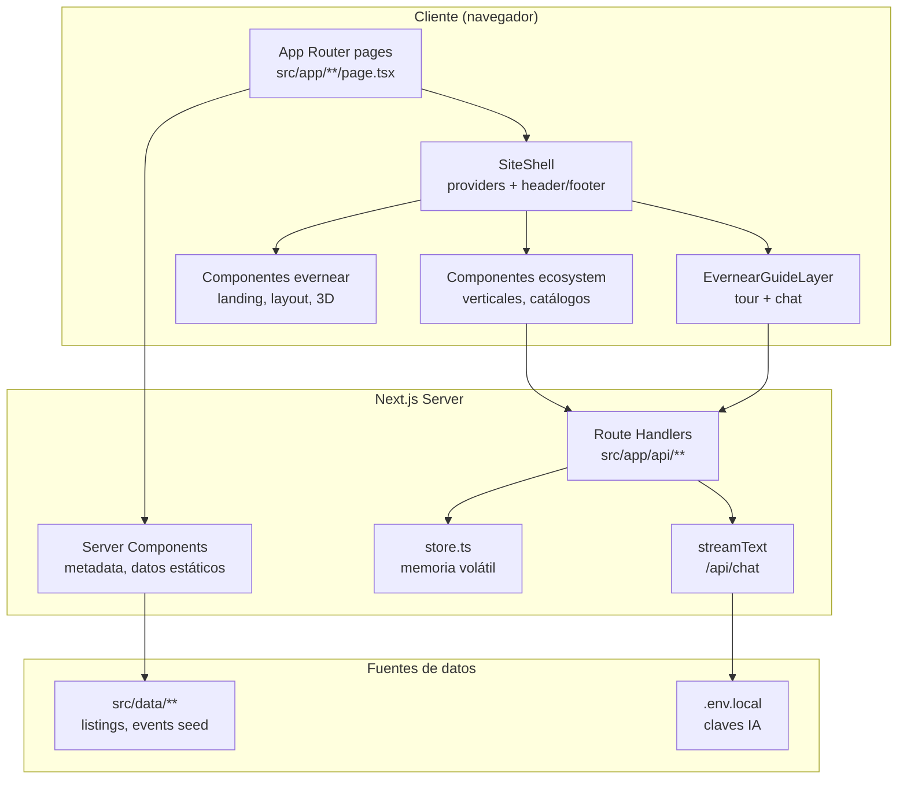
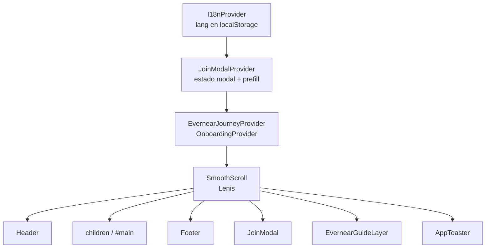
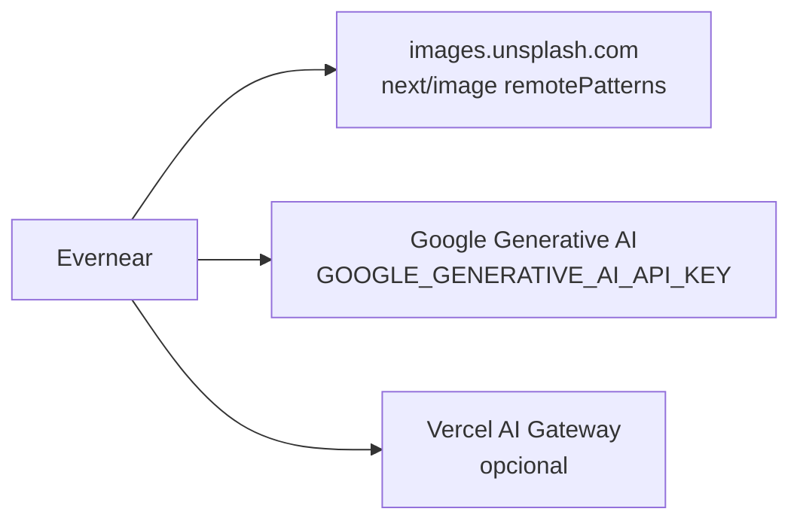

# Arquitectura

## Stack

| Capa | Tecnología |
|------|------------|
| Framework | Next.js 16 (App Router) |
| UI | React 19, Tailwind CSS 4, CSS en `src/styles/` |
| 3D / motion | Three.js, `@react-three/fiber`, Lenis (scroll suave) |
| IA | Vercel AI SDK (`ai`, `@ai-sdk/react`, `@ai-sdk/google`) |
| Onboarding in-app | `@onboardjs/react` (tour de la mascota) |
| Toasts | Sonner |

## Vista en capas

## Árbol de providers (`SiteShell`)

Todo lo que usa navegación global envuelve el contenido con esta jerarquía:

Archivo: `src/components/evernear/SiteShell.tsx`.

## Patrones de página

1. **Landing y páginas editoriales**: importan `SiteShell` directamente (`page.tsx`, `que-es`, `pulso`).
2. **Verticales con catálogo**: `VerticalCatalogPage` → `VerticalPageShell` → `SiteShell` + hero + guía + catálogo.
3. **Verticales custom**: algunas rutas usan `VerticalPageShell` con contenido propio (`comercios`, `eventos`, `descubrimiento`).

## Módulos de dominio (`src/lib`)

| Módulo | Responsabilidad |
|--------|-----------------|
| `ecosystem/verticals.ts` | Slugs, rutas, navegación, acentos |
| `ecosystem/vertical-catalog.ts` | Config por vertical (filtros, audiencia, listings) |
| `ecosystem/types.ts` | Tipos de listings, eventos, pulso, etc. |
| `ecosystem/cities.ts` | IDs y etiquetas de ciudades |
| `ecosystem/vigencia.ts` | Ventanas demo para mostrar/ocultar ítems |
| `join-tracks.ts` | Tracks del wizard “Unirse” (sport, health, solidarity, innovation) |
| `evernear-sections.ts` | Secciones del tour según `pathname` |
| `storage/store.ts` | Persistencia temporal servidor |
| `ai/chat-model.ts` + `evernear-prompt.ts` | Modelo y system prompt del chat |

## Integraciones externas

## Despliegue

- Build estándar: `npm run build` / `npm start`.
- Sin middleware de auth ni edge config en el repo actual.
- Metadatos OG en `src/app/` (`opengraph-image`, `twitter-image`, etc.).
