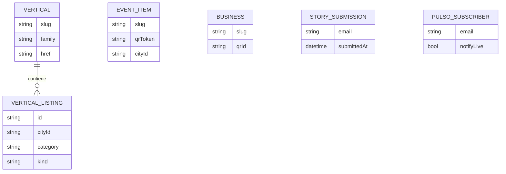
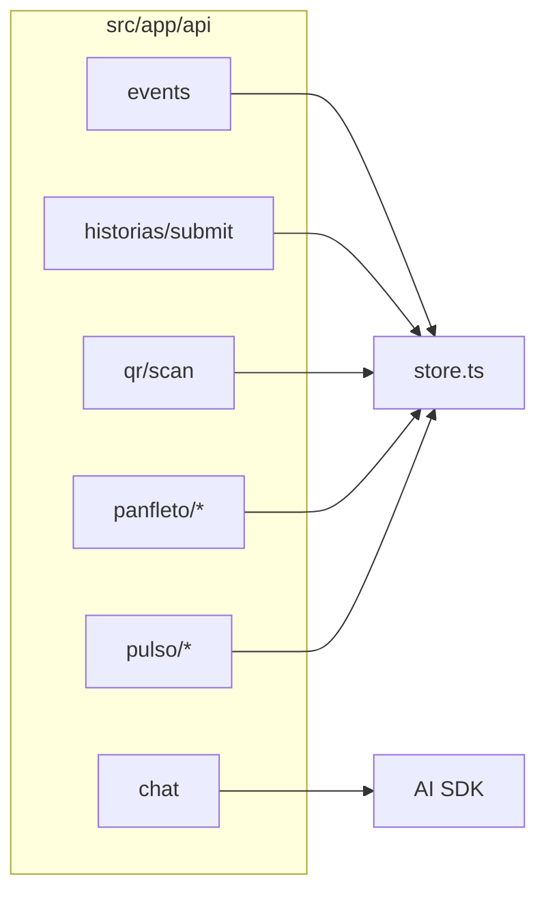
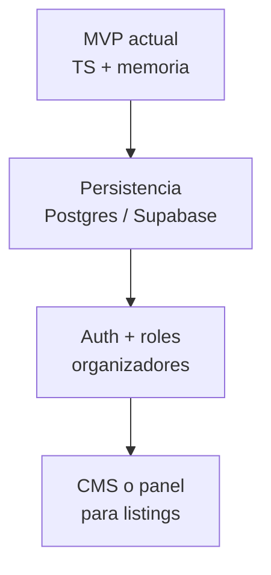

# Datos y APIs

## Modelo de datos actual

Los catálogos son **archivos TypeScript** importados en build time. Las entidades dinámicas viven en memoria en el servidor.

## Catálogos estáticos

| Ubicación | Contenido |
|-----------|-----------|
| `src/data/listings/*.ts` | Listings unificados por vertical |
| `src/data/sport.ts` | Deporte (mapeado a `VerticalListing`) |
| `src/data/events.ts` | Seed de eventos |
| `src/data/stories.ts` | Historias publicadas |
| `src/data/pulso-*.ts` | Ediciones e ítems de Pulso |
| `src/data/commerce.ts`, `tourism.ts`, etc. | Datos auxiliares por dominio |
| `src/lib/images/listing-images.ts` | Metadatos de imágenes por listing |

**Vigencia demo**: `applyDemoWindow` en `vigencia.ts` ajusta fechas visibles para demos.

## Store en memoria (`src/lib/storage/store.ts`)

| Función | Uso |
|---------|-----|
| `getEvents` / `addEvent` / `getEventBySlug` | Eventos publicados vía API |
| `subscribePanfleto` / `addPanfletoEntry` | Panfleto comercios |
| `recordQrScan` / `getQrScanCount` | Contador QR |
| `submitStory` / `getStorySubmissions` | Historias enviadas |
| `subscribePulso` / `getPulsoSubscribers` | Suscriptores Pulso |
| `addPulsoItem` / `getPulsoItemsFromStore` | Ítems extra en runtime |

> En despliegues serverless, cada instancia tiene su propia memoria; no usar este store como fuente de verdad en producción.

## APIs (Route Handlers)

| Método | Ruta | Descripción |
|--------|------|-------------|
| GET | `/api/events` | Lista eventos (seed + creados) |
| POST | `/api/events` | Crea evento; genera `slug` y `qrToken` |
| POST | `/api/historias/submit` | Guarda envío de historia |
| GET/POST | `/api/qr/scan` | Lee/registra escaneo por `token` |
| GET | `/api/panfleto/preview` | Vista previa entradas demo |
| POST | `/api/panfleto/subscribe` | Email suscriptor panfleto |
| POST | `/api/panfleto/entry` | Alta negocio en panfleto |
| GET | `/api/pulso/preview` | Preview contenido Pulso (query params) |
| POST | `/api/pulso/subscribe` | Suscripción Pulso (+ intereses / live) |
| POST | `/api/chat` | Stream de chat Conexa (UI messages) |

### Chat (`/api/chat`)

- Sanitiza mensajes (máx. 16, texto recortado).
- System prompt: `conexaInstructions` con idioma y pathname.
- Proveedor: `chatProvider()` → Google API key o AI Gateway (`chat-model.ts`).

Variables: ver `.env.example` y `scripts/setup-ai-chat.ps1`.

## Qué no tiene backend todavía

- Formulario **Unirse** (`JoinModal`): solo `console.log`.
- Usuarios, sesiones, CMS y base de datos (placeholders en `.env.example`).

## Evolución recomendada

Al migrar, mantener tipos en `src/lib/ecosystem/types.ts` como contrato y reemplazar implementaciones en `store.ts` por un repositorio real.
