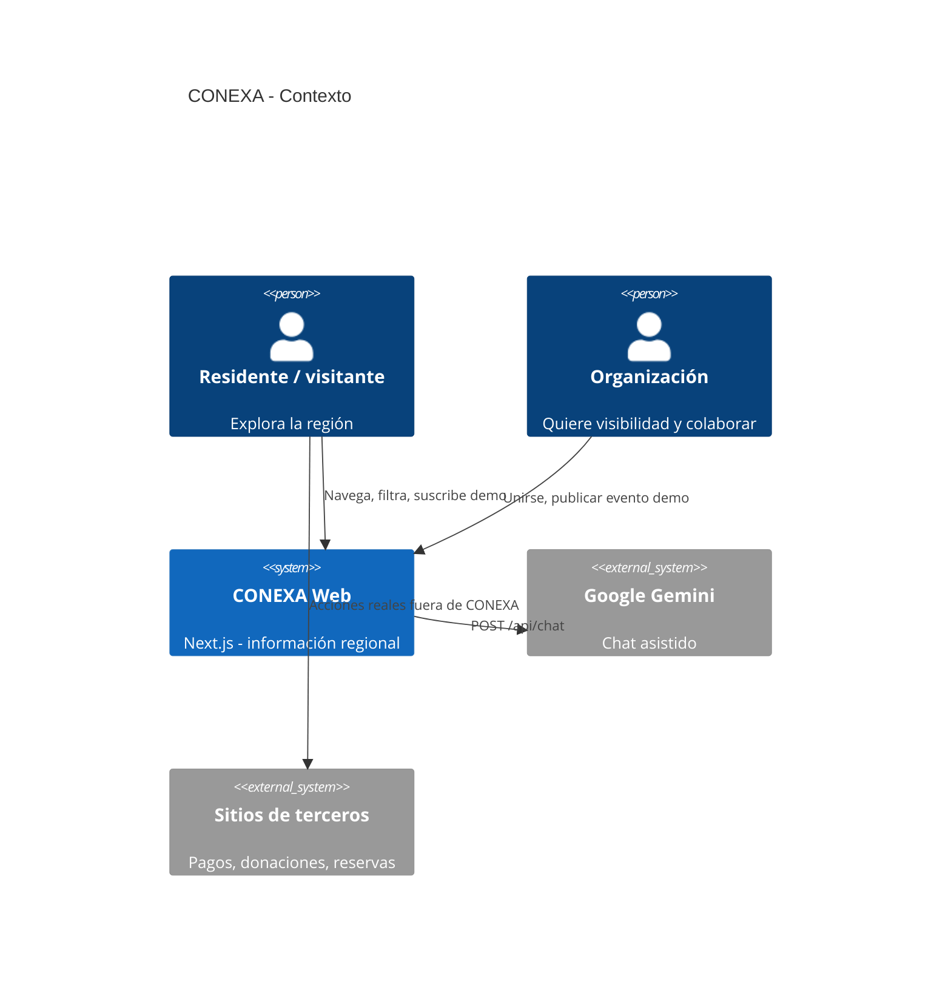
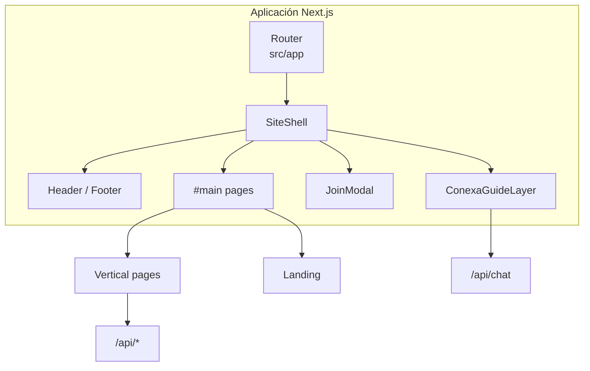
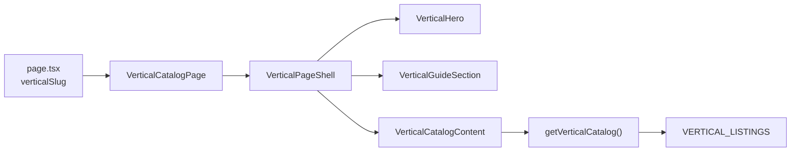
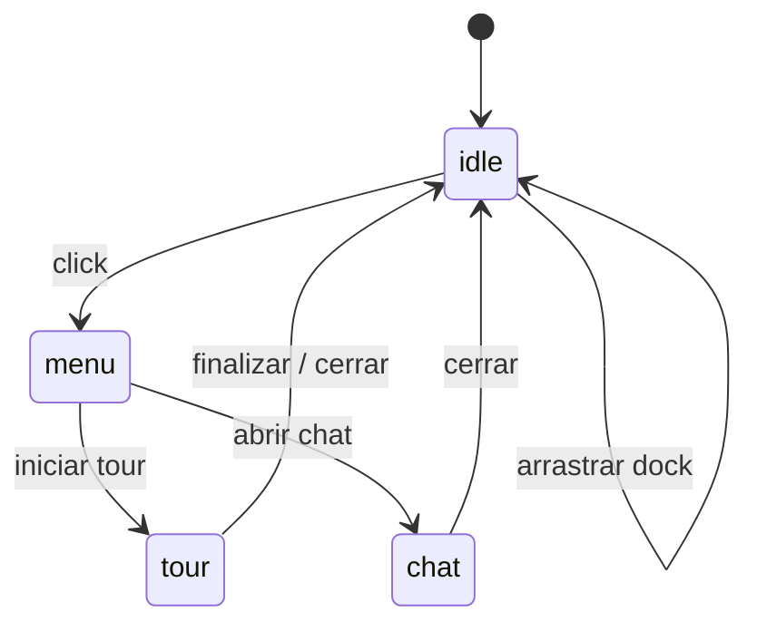
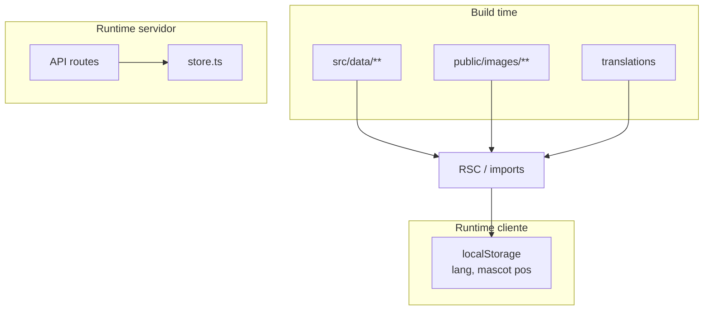
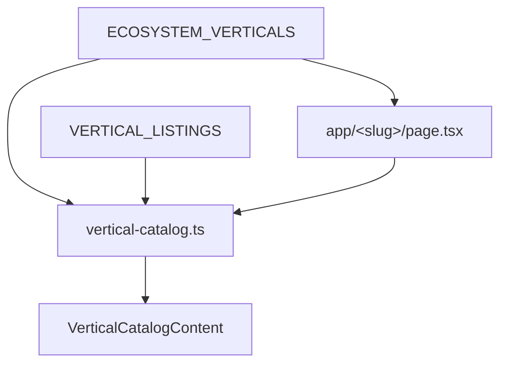
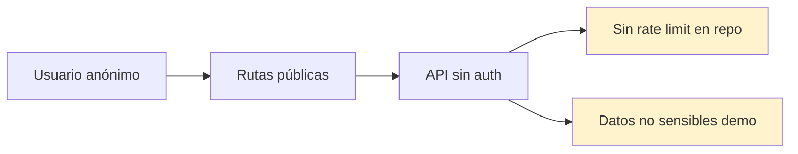

# Diagramas de referencia (Mermaid)

Copia estos bloques en GitHub, GitLab, Notion o cualquier visor compatible con Mermaid.

## 1. Contexto del sistema (C4 simplificado)

> Nota: el diagrama C4 requiere extensión Mermaid con soporte `C4Context`. Si no renderiza, usa el diagrama flowchart de `arquitectura.md`.

## 2. Componentes del cliente

## 3. Pipeline de una vertical tipo catálogo

## 4. Estados de la mascota Conexa

## 5. Dependencias de datos (build time vs runtime)

## 6. Matriz vertical → listing → página

## 7. Seguridad y límites actuales

Al acercarse a producción real: autenticación para publicadores, rate limiting en `/api/chat`, persistencia y validación server-side reforzada.

---

## 8. Enlace a mapas por ruta

Todos los diagramas de decisión del ecosistema (home, 11 verticales, pulso, QR, legal, etc.) están en **[mapas-decision-rutas.md](./mapas-decision-rutas.md)**.

Diagramas relacionados con más detalle narrativo:

- [Arquitectura](./arquitectura.md)
- [Flujos de usuario](./flujos-usuario.md)
- [Datos y APIs](./datos-apis.md)
