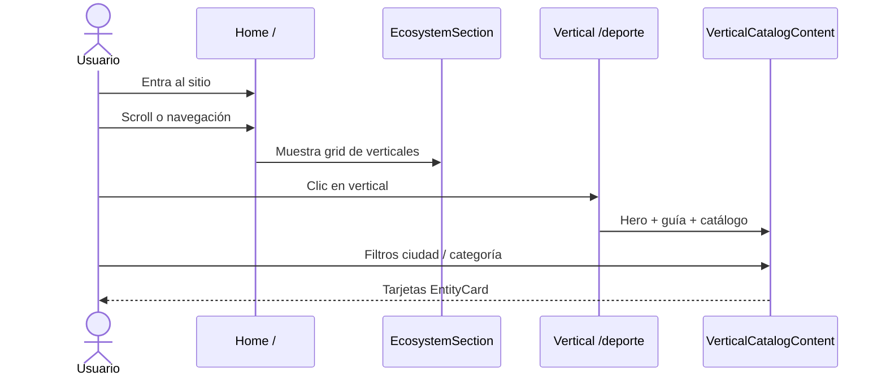
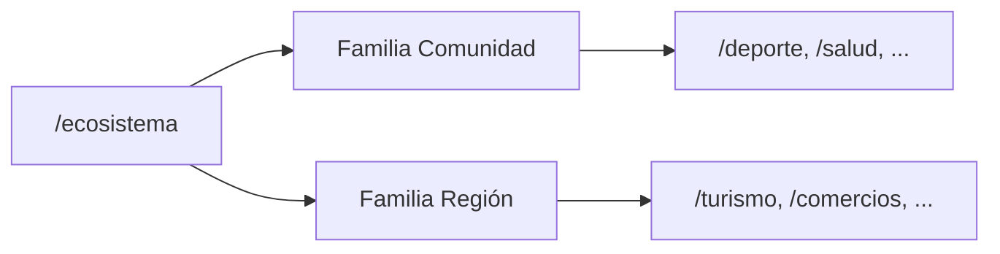
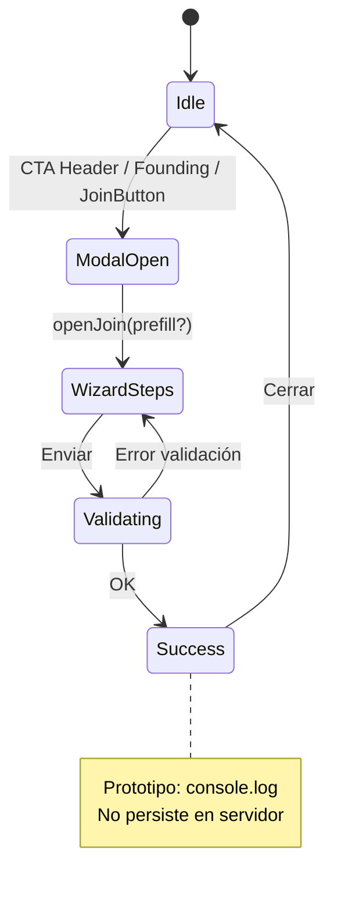
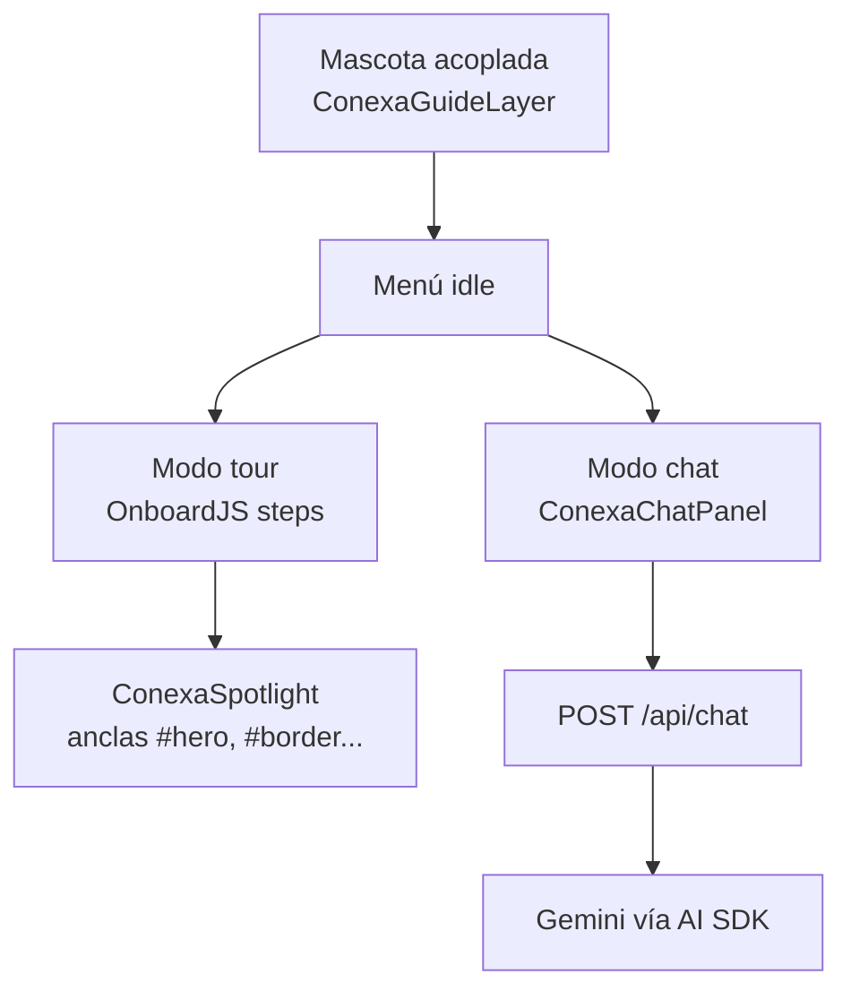
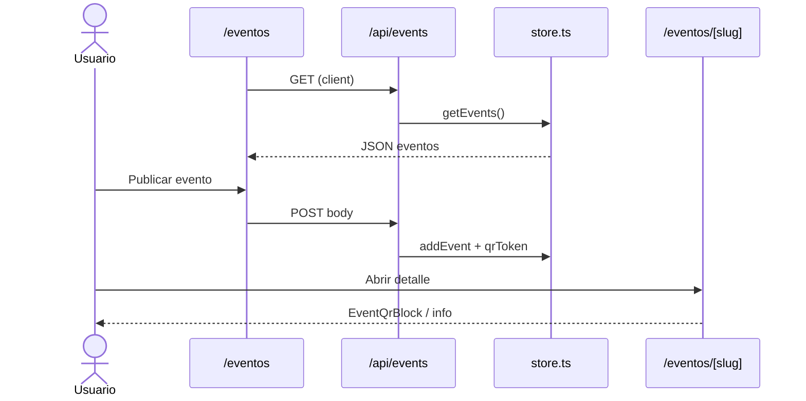
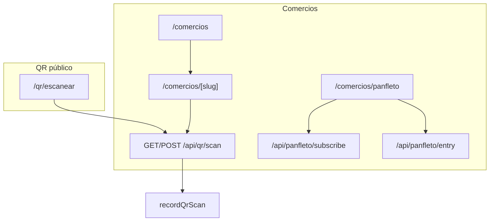
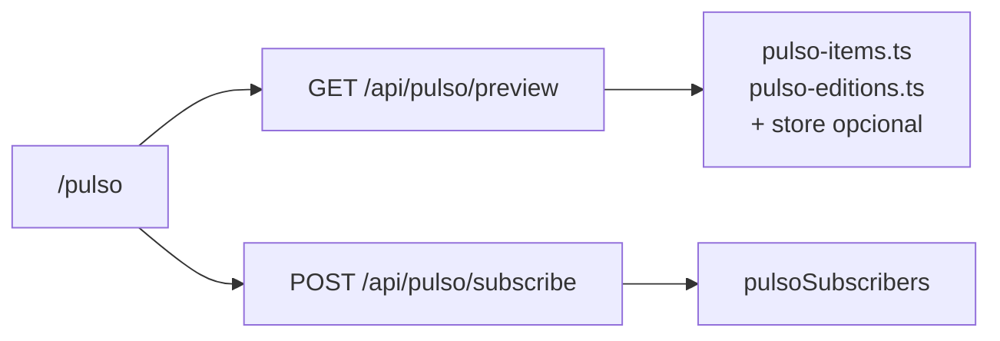
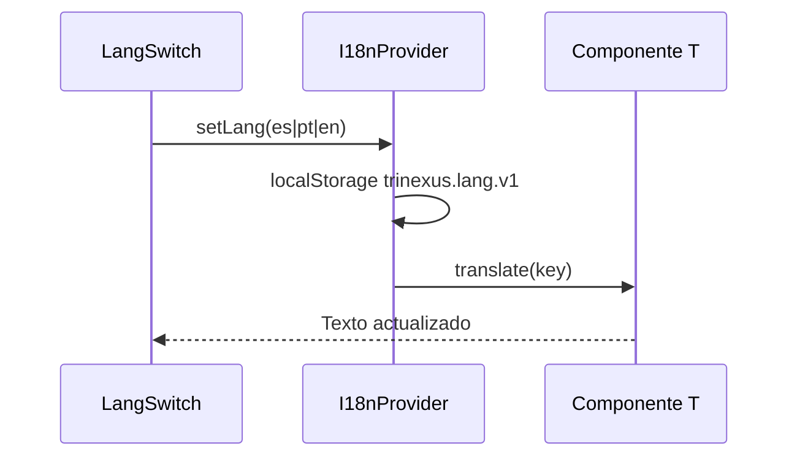
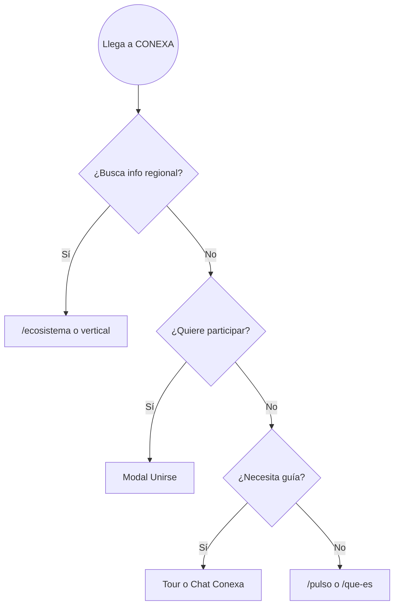

# Flujos de usuario

Este documento describe recorridos típicos y cómo se conectan con rutas, componentes y APIs.

## Flujo 1: Descubrimiento desde la home

**Puntos clave**

- La home no carga datos remotos; es composición de secciones estáticas.
- Cada vertical usa listings de `VERTICAL_LISTINGS` (`src/data/listings/index.ts`).

## Flujo 2: Explorar el ecosistema completo

`EcosystemIndexPage` reutiliza `COMMUNITY_VERTICALS` y `REGION_VERTICALS` de `verticals.ts`.

## Flujo 3: Unirse a CONEXA (organización o persona)

**Entradas al modal**

- Botón “Unirse” en header (`JoinButton`).
- Sección founding en home.
- Prefill por vertical vía `joinTrack` en `vertical-catalog` (deporte, salud, solidaridad, innovación).

**Implementación**: `JoinModal.tsx` + `JoinModalProvider.tsx`.

## Flujo 4: Tour y chat con Conexa (mascota)

- Pasos del tour: `buildConexaJourneySteps` + `getConexaSections(pathname)`.
- Posición de la mascota: `localStorage` (`conexa-mascot-pos-v1`).
- El chat envía `pathname` y `lang` para contextualizar respuestas (`conexa-prompt.ts`).

## Flujo 5: Eventos (listado + publicar + detalle)

Seed inicial: `SEED_EVENTS` en `src/data/events.ts`.

## Flujo 6: Comercios, QR y panfleto

Los comercios demo incluyen `qrId`; el contador de escaneos es volátil.

## Flujo 7: Historias de la comunidad

1. Usuario en `/que-es#historias` ( `/historias` redirige con `RedirectToCommunityHash`).
2. Formulario `StorySubmitForm` → `POST /api/historias/submit` → `submitStory()` en store.
3. Contenido curado estático en `src/data/stories.ts` y componentes `stories/*`.

## Flujo 8: Pulso semanal

UI modular en `src/components/ecosystem/pulso/*` y estilos `src/styles/pulso.css`.

## Flujo 9: Cambio de idioma

Traducciones: `src/lib/i18n/translations.ts` (generado/acompañado por `scripts/build-translations.mjs`).

## Mapa de decisión rápido (usuario nuevo)

