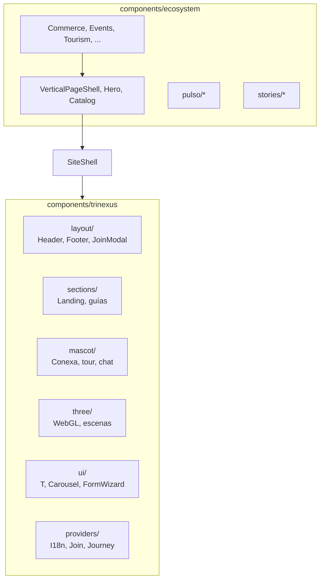

# Frontend y componentes

## Dos familias de componentes

| Carpeta | Cuándo usar |
|---------|-------------|
| `trinexus` | Marca CONEXA, shell global, landing, utilidades UI, mascota, 3D |
| `ecosystem` | Páginas de verticales, catálogos, formularios de dominio |

## Componentes clave

### Internacionalización

- `I18nProvider`: idioma y función `t(key)`.
- `T` / `THtml`: render de claves con fallback.
- `LangSwitch`: selector en header.

### Formularios

- `FormWizard`: pasos del modal Unirse.
- Formularios de dominio en `ecosystem/*` (eventos, historias, panfleto).

### Catálogo vertical

- `VerticalCatalogContent`: filtros + grid `EntityCard`.
- `VerticalGuideSection`: guía editorial por vertical (claves en `vertical-guides.ts`).

### Imágenes

- `TrinexusPhoto`, `ConexaMascotImage`: rutas bajo `public/images/`.
- Registro central en `src/lib/images.ts` y `listing-images.ts`.

## Estilos

| Archivo | Alcance |
|---------|---------|
| `src/app/globals.css` | Tailwind + imports base |
| `src/styles/trinexus.css` | Sistema visual principal |
| `src/styles/community-map.css` | Mapa comunitario |
| `src/styles/pulso.css` | Pulso semanal |
| `src/styles/que-es.css` | Página qué es |
| `src/styles/carousel.css` | Carruseles |

Acentos por vertical: clases derivadas de `accent` en `EcosystemVertical` (sport, health, etc.).

## Hooks propios (`src/hooks`)

| Hook | Uso |
|------|-----|
| `useNavSolid` | Header sólido al scroll |
| `useReveal` | Animaciones de entrada |
| `useCarousel` / `useCarouselPanOffset` | Carruseles |
| `useConexaScrollScrub` | Mascota reacciona al scroll |

## Three.js

Escenas en `components/trinexus/three/`:

- Landing / companion: `ConexaScrollCompanion`, `BridgeScene`, etc.
- Carga diferida vía `Scene3DCanvas` donde aplica.

Respetar `prefers-reduced-motion` (patrón usado en mascota y 3D).

## Alias de importación

`@/` → `src/` (config estándar Next/TS).

## Checklist al tocar UI

1. ¿La clave i18n existe en los tres idiomas o hay fallback aceptable?
2. ¿La página usa `SiteShell` o `VerticalPageShell` para mantener nav y mascota?
3. ¿Formularios nuevos deben ir a API + store o a servicio externo?
4. ¿Accesibilidad: `#main`, skip link, foco en modales?
