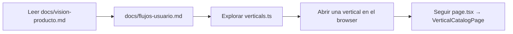
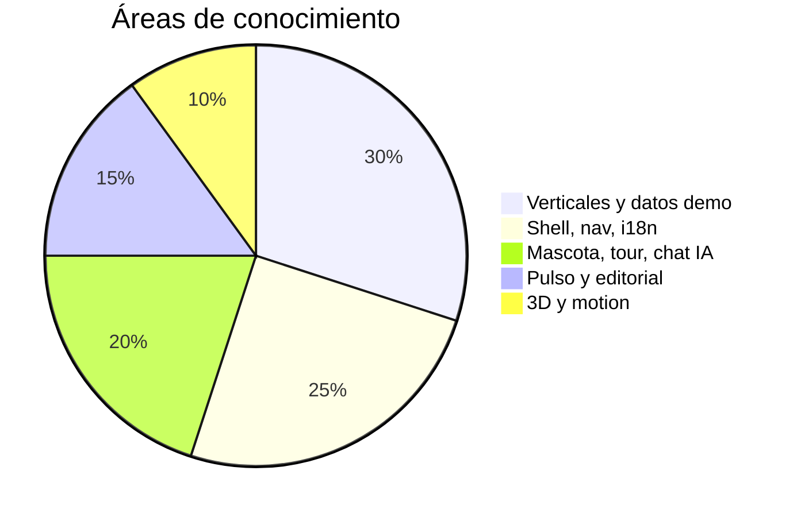

# Onboarding del equipo

Guía para desarrolladores, diseño y producto que incorporan al repositorio **trinexus** (producto **CONEXA**).

## Día 1: entorno local

### Requisitos

- Node.js 20+ (recomendado LTS).
- npm (lockfile: `package-lock.json`).

### Pasos

```bash
cd trinexus
npm install
cp .env.example .env.local
npm run dev
```

Abrir [http://localhost:3000](http://localhost:3000).

### Variables opcionales pero útiles

| Variable | Para qué |
|----------|----------|
| `NEXT_PUBLIC_APP_URL` | URLs absolutas en desarrollo |
| `GOOGLE_GENERATIVE_AI_API_KEY` | Chat de Conexa en local |
| `GOOGLE_GENERATIVE_AI_MODEL` | Override del modelo (default `gemini-2.5-flash`) |

En Windows existe `scripts/setup-ai-chat.ps1` para automatizar parte del setup de chat.

### Comandos npm

| Comando | Acción |
|---------|--------|
| `npm run dev` | Servidor de desarrollo |
| `npm run build` | Build de producción |
| `npm run start` | Servir build |
| `npm run lint` | ESLint |

## Día 2: mental model del código



### Archivos “north star”

1. `src/lib/ecosystem/verticals.ts` — mapa del producto.
2. `src/components/trinexus/SiteShell.tsx` — envoltorio global.
3. `src/data/listings/index.ts` — datos de catálogo.
4. `src/lib/storage/store.ts` — qué persiste hoy en servidor.

### Next.js en este repo

El proyecto usa **Next.js 16** con convenciones que pueden diferir de versiones anteriores. Antes de cambiar routing o APIs del framework, revisar la documentación embebida en `node_modules/next/dist/docs/` (ver `AGENTS.md`).

## Día 3: tareas típicas

| Tarea | Dónde trabajar |
|-------|----------------|
| Nueva tarjeta en catálogo | `src/data/listings/<vertical>.ts`, imágenes en `listing-images.ts` |
| Copy en tres idiomas | claves en fuentes i18n + `scripts/build-translations.mjs` si aplica |
| Nueva sección en landing | `src/app/page.tsx` + `components/trinexus/sections/` |
| Endpoint que guarda datos | `src/app/api/...` + funciones en `store.ts` (o futuro DB) |
| Ajustar tour mascota | `src/lib/conexa-sections.ts`, `conexa-journey-steps.ts` |
| Pulso / editorial | `src/data/pulso-*.ts`, `components/ecosystem/pulso/` |

## Scripts de mantenimiento (`scripts/`)

| Script | Propósito |
|--------|-----------|
| `build-translations.mjs` | Construir/actualizar traducciones |
| `build-images.mjs` | Pipeline de imágenes |
| `gen-vertical-guides.mjs` / `vertical-guides-i18n.mjs` | Guías por vertical |
| `validate-unsplash-ids.mjs` | Validar IDs Unsplash |
| `patch-nav-i18n.mjs`, `patch-conexa-i18n.mjs` | Parches masivos de claves |

Ejecutar con `node scripts/<nombre>.mjs` desde la raíz del repo.

## Convenciones de equipo

- **TypeScript estricto** en tipos de dominio (`ecosystem/types.ts`).
- **Claves i18n** en lugar de strings fijos en UI (excepto prototipos puntuales).
- **Client components** solo cuando hay estado, efectos o browser APIs (`"use client"`).
- **Commits**: mensajes claros en español o inglés según costumbre del equipo; no commitear `.env.local`.

## Roles y ownership sugerido



## Preguntas frecuentes

**¿Por qué los datos desaparecen al redeploy?**  
Porque el store es en memoria. Ver `docs/datos-apis.md`.

**¿El formulario Unirse guarda leads?**  
No; es prototipo (`console.log` en `JoinModal.tsx`).

**¿Cómo pruebo el chat sin pagar?**  
API key gratuita de Google AI Studio (`GOOGLE_GENERATIVE_AI_API_KEY`).

**¿Dónde está el diseño legacy?**  
`public/trinexus.html` es referencia histórica; la app vive en Next.js bajo `src/`.

## Checklist de primera contribución

- [ ] Correr `npm run dev` y recorrer `/`, `/ecosistema`, una vertical y `/pulso`.
- [ ] Cambiar idioma y verificar una clave en `pt` o `en`.
- [ ] Leer `docs/arquitectura.md` y `docs/datos-apis.md`.
- [ ] Abrir PR con capturas si hay cambio visual.
- [ ] Confirmar `npm run build` sin errores antes de merge.
