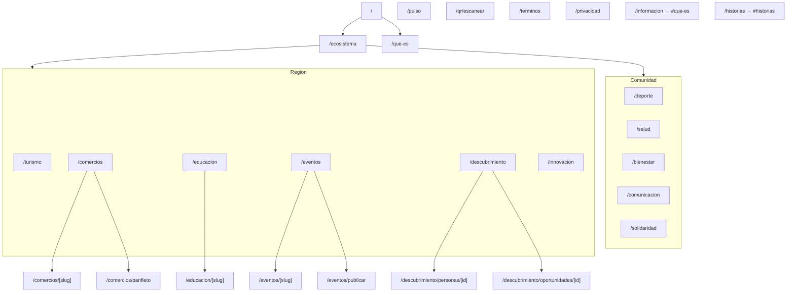

# Rutas y páginas

Todas las rutas viven bajo `src/app/` (App Router de Next.js).

## Mapa de rutas

## Tabla de páginas

| Ruta | Componente principal | Shell |
|------|----------------------|-------|
| `/` | Secciones landing | `SiteShell` |
| `/ecosistema` | `EcosystemIndexPage` | `SiteShell` |
| `/que-es` | `AboutContentPage` / showcase | `SiteShell` |
| `/pulso` | `PulsoPageContent` | `SiteShell` |
| `/deporte` … `/innovacion` (catálogo) | `VerticalCatalogPage` | `VerticalPageShell` |
| `/comercios` | `CommercePageContent` | `VerticalPageShell` |
| `/eventos` | `EventsPageContent` | vía contenido propio |
| `/turismo` | `TourismPageContent` | `VerticalPageShell` |
| `/descubrimiento` | `DiscoveryPageContent` | `VerticalPageShell` |
| `/comercios/[slug]` | `BusinessDetailContent` | `VerticalPageShell` |
| `/eventos/[slug]` | detalle evento | `VerticalPageShell` |
| `/eventos/publicar` | `PublishEventForm` | `VerticalPageShell` |
| `/educacion/[slug]` | curso / programa | `VerticalPageShell` |
| `/descubrimiento/personas/[id]` | perfil | `VerticalPageShell` |
| `/descubrimiento/oportunidades/[id]` | oportunidad | `VerticalPageShell` |
| `/qr/escanear` | `QrScanContent` | `SiteShell` |
| `/terminos`, `/privacidad` | legal | según página |
| `/informacion`, `/historias` | `RedirectToCommunityHash` | redirect cliente |

## Navegación global

Definida en `src/lib/ecosystem/verticals.ts`:

- `ECOSYSTEM_NAV_GROUPS`: dropdown “Ecosistema” (comunidad + región).
- `COMMUNITY_NAV_LINKS`: enlaces institucionales (qué es, historias, términos).
- `ABOUT_NAV_LINKS`: visión y CTA unirse.

Header: `src/components/trinexus/layout/Header.tsx`.

## Metadata y SEO

- Raíz: `src/app/layout.tsx` (`metadata`, `viewport`).
- Páginas específicas exportan `metadata` donde aplica (ej. `/pulso`).
- Imágenes sociales: `opengraph-image`, `twitter-image` en `src/app/`.

## Convención para nuevas verticales

1. Añadir entrada en `ECOSYSTEM_VERTICALS`.
2. Crear listings en `src/data/listings/<vertical>.ts` y registrar en `listings/index.ts`.
3. Extender `getVerticalCatalog` en `vertical-catalog.ts` (audiencia, filtros, claves i18n).
4. Crear `src/app/<slug>/page.tsx` con `VerticalCatalogPage` o contenido custom.
5. Añadir claves de traducción y, si aplica, secciones de tour en `conexa-sections.ts`.
