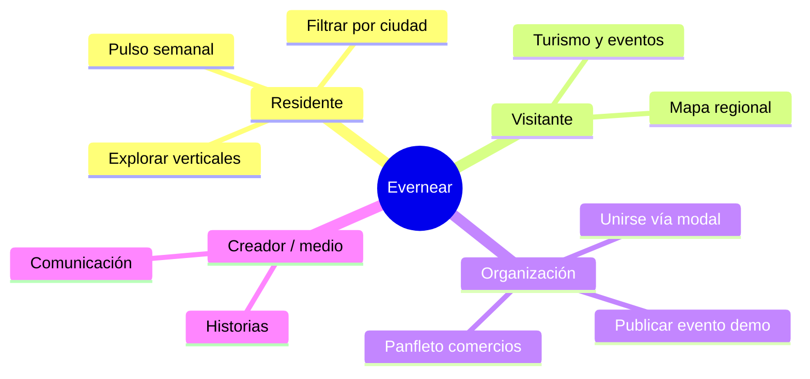

# Visión y producto

## Propósito

Evernear conecta a personas y organizaciones con **deporte, salud, bienestar, comunicación, solidaridad, turismo, comercios, educación, eventos, descubrimiento e innovación** en una misma experiencia regional.

La plataforma es **solo informativa**: no procesa pagos, donaciones ni rifas. Las acciones concretas (inscripciones, compras, donaciones) ocurren fuera de Evernear, con cada organizador.

## Región de lanzamiento

Triple Frontera, modelada con tres ciudades (`pi`, `foz`, `cde`) en `src/lib/ecosystem/cities.ts`.

## Verticales del ecosistema

Las verticales están definidas en `src/lib/ecosystem/verticals.ts` y se agrupan en dos familias:

| Familia | Verticales | Rol |
|---------|------------|-----|
| **Comunidad** | deporte, salud, bienestar, comunicación, solidaridad | Vida comunitaria, salud y medios |
| **Región** | turismo, comercios, educación, eventos, descubrimiento, innovación | Economía, formación y talento |

Algunas verticales están marcadas como `informational: true` (contenido orientativo, sin catálogo transaccional).

## Audiencias principales

## Piezas transversales del producto

| Pieza | Ruta / ubicación | Función |
|-------|------------------|---------|
| Landing | `/` | Hero, frontera, personas, ecosistema, founding |
| Índice ecosistema | `/ecosistema` | Grid de todas las verticales |
| ¿Qué es? | `/que-es` | Visión, historias, CTA unirse |
| Pulso semanal | `/pulso` | Radar editorial / suscripción demo |
| Mascota Evernear | Flotante en `SiteShell` | Tour guiado, chat IA, atajos |
| Modal “Unirse” | Global | Wizard persona u organización (prototipo) |
| i18n | `es` / `pt` / `en` | Textos vía claves en `src/lib/i18n/` |

## Estado actual (MVP demo)

- **Catálogos**: datos TypeScript en `src/data/` y `src/data/listings/`, con ventanas de vigencia demo (`applyDemoWindow`).
- **Formularios dinámicos**: eventos, historias, panfleto, pulso, QR → APIs que persisten en **memoria del servidor** (`src/lib/storage/store.ts`); se pierden al reiniciar el proceso.
- **Join**: el envío del modal registra en `console.log` (no hay backend de leads).
- **Chat**: requiere `GOOGLE_GENERATIVE_AI_API_KEY` o Vercel AI Gateway (ver `.env.example`).

## Roadmap implícito en el código

Comentarios y variables en `.env.example` anticipan `DATABASE_URL` y `AUTH_SECRET` cuando se elija proveedor e implemente autenticación.
